# Lab2：BombLab 实验报告

> 课程：计算机系统基础（2026 年秋季学期）
> 实验：Lab2 — BombLab
> 个人仓库：https://github.com/ProvyP/ics-2026-bomblab

## 零、概述

本次实验在流程上分成四个部分：

1、clone 项目并完成 tutor 的学习。通过对比 .c 文件和反汇编文件、分析反汇编文件，逐渐清楚项目的完成思路和路径

2、处理 Phase 1 ~ Phase 6。

3、处理 honor，并整理截图、与 AI 的对话、运行结果。做出一版 `report.md`。

4、重新复盘所有 phase，并提取出共性的研究思路，然后把新的总结加入报告。

### 0.1 辅助工具使用说明与 AI / 个人贡献说明

实验主要使用 `objdump`、`nm`、GDB、GCC、GNU Make、Python 公开测试脚本和 Git/GitHub。`objdump` 用于静态查看函数和控制流；GDB 用于观察寄存器、内存及读取 Phase 3、5、6 的表项；公开测试和额外 seed 运行用于验证计算关系；GitHub Actions 用于检查已推送版本的公开自测结果。

本实验主要使用了 **ChatGPT** 辅助讨论汇编含义、梳理计算关系、设计和检查 `defuser.c` 实现、排查 GDB 命令问题，以及整理实验报告结构、编辑文字；实验记录中另有与 **DeepSeek** 的补充讨论。特别是各关计算公式和对寄存器的使用顺序问题，曾接受 AI 的分析与建议，不能仅将工具回复当作原始分析证据。实验中的命令、运行截图、GDB 观察、测试和 Git 提交均来自本人实际操作，报告里的具体数值关系以个人炸弹的汇编和测试结果为依据。

本报告第三节中围绕**函数原型、特殊指令、寄存器流动**展开的 Phase 1 分析，来自个人在完成求解后重新阅读汇编时写下的**独立**复盘，在编入报告时 AI 仅对少数类型和控制流表述作了技术修正。其余关卡的推导和文字整理结合了实验记录、参考资料及上述工具辅助。通过重新追踪关键指令与数据流，我希望确保自己能够解释最终提交的代码，而不只是重复测试通过的结论。

## 一、实验目标与思路

本次实验需要分析一个没有提供 C 源码的个人 `bomb` 可执行文件，在 `defuser.c` 中实现对应的通用求解算法。程序根据 seed 生成各关的 64 位 `challenge`；每一关读取一行口令，检查输入是否满足与 challenge 有关的条件。我们的任务不是找到六组固定答案，而是对任意 challenge 计算出满足检查条件的输入。

从代码角度看，这相当于一种有明确目标的逆向分析：先用 `objdump` 得到汇编，识别验证逻辑以及计算答案的关键函数，再把这些计算关系恢复为 C 语言。这里的“恢复”不要求还原出完全相同的原始源码，重点是写出行为等价、可以通过不同 seed 测试的求解函数。

模板已经提供了输出接口，以 Phase 1 为例：

```c
int solve_phase_1(uint64_t challenge, char *out, size_t cap) {
    uint32_t values[MAX_FIELDS] = {0};
    size_t count = 0;
    (void)challenge;
    // TODO: 根据 phase_01 的汇编计算答案
    return write_answer(out, cap, values, count);
}
```

`challenge` 是输入的无符号 64 位挑战值；`values` 存放本关的口令整数（模板最多支持 8 个）；`count` 是实际输出的整数个数；`write_answer` 把这些整数依次写成以空格分隔的十进制字符串，放入 `out` 指向的缓冲区，`cap` 用于检查容量。求解时只需要填好 `values`、`count`，不必修改模板的输出逻辑。Honor 使用独立的 `solve_secret` 接口，格式稍有不同。

我的分析原则是先确认程序**检查什么**，再追踪被检查的数**从哪里来、怎样计算**。因此不按反汇编文件的行号机械阅读，而优先找函数调用、输入解析、关键比较和数据流，逐步缩小需要反编译的范围。

## 二、实验环境与准备

### 2.1 环境配置

实验继续使用 Lab0 配置的 Windows + WSL（Ubuntu）环境：

| 项目 | 环境 |
| --- | --- |
| 操作系统 | Windows + WSL，Linux x86-64 |
| 工作目录 | `/home/provencep/ICS2026/BombLab` |
| 编辑器 | Visual Studio Code（WSL） |
| Git | 2.53.0 |
| GCC | 15.2.0 |
| GNU Make | 4.4.1 |
| Python | 3.14.4 |
| GDB | 17.1 |
| GNU binutils / objdump | 2.46 |

使用 GitHub 模板创建个人仓库，配置 SSH 并克隆到本地。相关的环境检查结果如下。

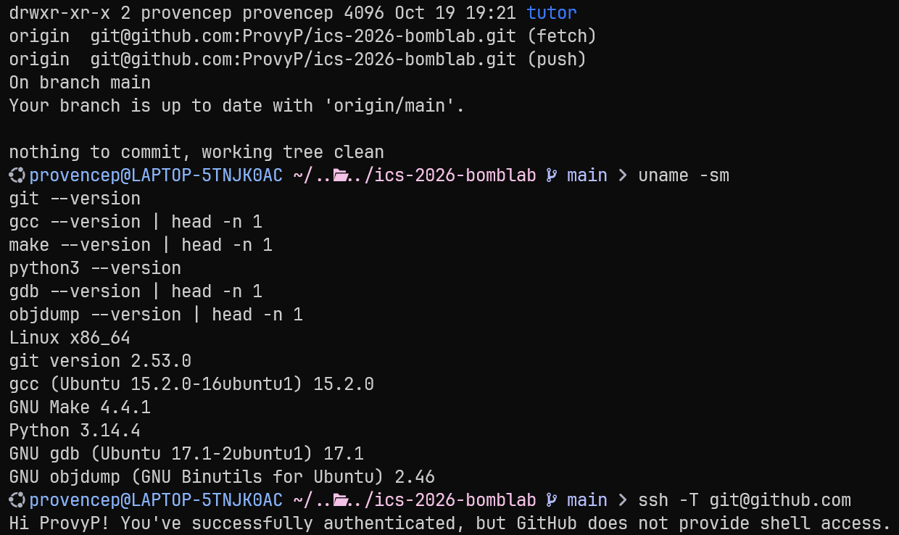

### 2.2 领取个人炸弹

临时在 `config.txt` 中填写学号后，执行：

```bash
make bomb
make
```

下载时普通入口曾出现连接、读取超时，脚本随后自动切换到 GitHub API 完成下载。编译得到 `defuser` 后，使用 `file bomb` 确认它是 x86-64 ELF 可执行文件，通过 `nm -n bomb` 确认存在 `phase_01` 至 `phase_06` 等符号。最后恢复 `config.txt`，避免在 Git 历史中提交学号。

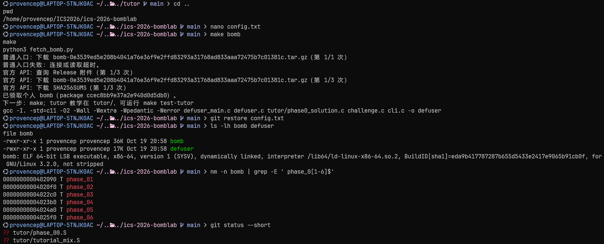

### 2.3 Tutor 与基本工具

正式分析前完成了 Tutor 教学关，用它熟悉 `objdump`、GDB 以及函数参数的寄存器传递。教学关的计算关系比较简单：

```c
uint32_t first  = (uint32_t)((challenge >> 5) & 255U) ^ 42U;
uint32_t second = 3U * first + 7U;
```

对于 seed 42，输入 `0 0` 时会 BOOM；在 GDB 的比较指令处观察到程序期望的第一个整数是 94，最终使用 `94 289` 成功通过。教学关十个公开 seed 均通过。

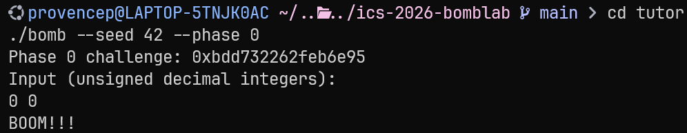

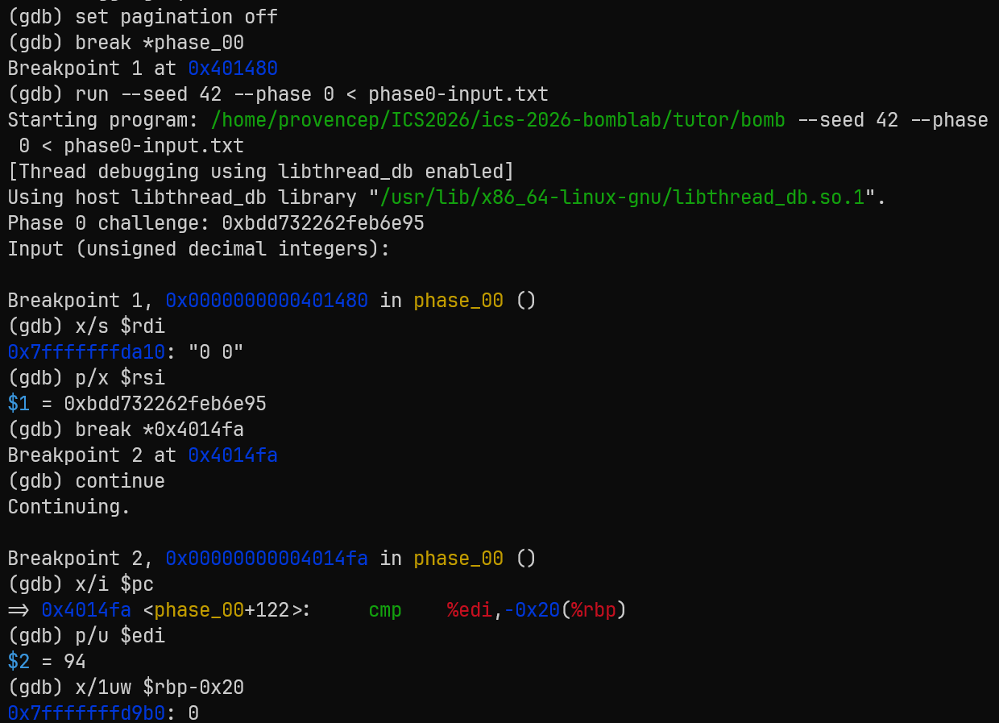

这部分的直接收获是：可以先通过静态汇编恢复运算关系，再用 GDB 在关键时刻验证寄存器和内存。对于正式关卡，若静态分析已经足以确认公式，就不必为了使用 GDB 而重复单步调试。

## 三、Phase 1：从函数原型、控制流和寄存器流动建立分析框架

Phase 1 带给我最大的启示，是逆向分析时应先关注三件事：

1. 当前函数及其调用函数的**参数类型、参数数量、返回值类型**；
2. `call`、跳转、`ret`、`cmp`、`test`、`setcc`、`push`、`pop` 等影响程序组织的指令；
3. **寄存器中的值如何流动**，即 challenge、输入和计算结果分别从哪里来到哪里去。

这三件事不一定直接给出密码，却能让我先把汇编的总体组织搭起来。对 Phase 1，我把“分析架构”与“恢复计算公式”分开处理。

### 3.1 函数的类型和参数：先找已有信息，再根据调用推断

判断函数原型有几种途径，可以结合使用，比只依靠某一种方法高效。

**第一，参考 Tutor 的接口。** Tutor 中有：

```c
bool phase_00(const char *input, uint64_t challenge);
```

正式关卡使用相同的调用框架，所以可以把 `phase_01` 初步理解成：

```c
bool phase_01(const char *input, uint64_t challenge);
```

**第二，查看头文件或课程提供的源码。** 例如辅助函数的接口为：

```c
bool valid_u32_fields(const char *input, size_t count);
```

**第三，利用已知的标准库原型。** `sscanf` 是：

```c
int sscanf(const char *str, const char *format, ...);
```

这里的 `...` 表示可变参数，后面传入多少个接收地址取决于格式字符串。不能因为某一次只传入一个整数地址，就把 `sscanf` 自身的标准原型改成固定的三个参数。

**第四，也是逆向时最常见的方式：根据调用现场推断。** 具体回到 `phase_01` 的汇编。

#### 3.1.1 `phase_01`：识别两个输入来源和布尔返回值

函数入口有：

```asm
40209a: mov    %rsi,%r12
4020a3: mov    %rdi,%rbx
```

Linux x86-64 的 System V ABI 使用 `rdi → rsi → rdx → rcx → r8 → r9` 传递前六个整数或指针参数。这里分别保留了原来的 `rdi` 和 `rsi`，说明这两个值以后还要使用；结合 Tutor 和后续调用，可以确认它们分别是输入字符串指针与 challenge。需要注意，单纯看到保存两个寄存器，并不能严格证明函数只有两个参数。

观察两个返回位置：

```asm
4020b7: xor    %eax,%eax
4020bd: ret
...
4020e3: sete   %al
4020ee: ret
```

失败路径将返回值置 0，成功走到末尾时 `sete` 根据相等标志设置 `al`，这符合返回布尔值的特征。由此可建立 `phase_01(input, challenge) -> bool` 的模型。

这里的 `mov %rsi,%r12`、`mov %rdi,%rbx` 是**寄存器间复制**，不是把两个值直接压入栈。函数另外使用 `push`、`pop` 保存与恢复需要遵守调用约定的寄存器。

#### 3.1.2 `valid_u32_fields`：确认整数个数

先看调用之前的指令：

```asm
40209d: mov    $0x1,%esi
4020aa: call   402ca0 <valid_u32_fields>
4020af: test   %al,%al
4020b1: jne    4020c0
```

`phase_01` 入口时的 `rdi` 仍保存输入字符串地址，原先的 `rsi` 已备份到 `r12`，然后 `%esi` 被设置为 1。因此这次调用可以写成：

```c
valid_u32_fields(input, 1);
```

结合辅助函数原型，1 是要求的无符号 32 位整数字段数。`test %al,%al` 又表明后面根据它的真假决定是否继续执行。这里写 `%esi` 并不意味着第二个参数原型一定是 `int`：向 32 位 `esi` 写 1 也会把 `rsi` 的高位清零，足以传入值为 1 的 `size_t`。

#### 3.1.3 `sscanf`：追踪输入字符串变成整数的过程

输入格式检查通过后，执行：

```asm
4020c2: lea    -0x14(%rbp),%rdx
4020c6: mov    $0x403189,%esi
4020cb: mov    %rbx,%rdi
4020ce: call   4011e0 <__isoc99_sscanf@plt>
4020d3: cmp    $0x1,%eax
4020d6: jne    4020b3
```

依次来看：

- `rdi` 重新接收 `rbx` 保存的原始输入字符串地址；
- `rsi` 指向 `0x403189` 处的格式字符串；
- `lea -0x14(%rbp),%rdx` 计算一个**栈上位置的地址**，供 `sscanf` 写入整数。

因此本次调用的实际形式近似为：

```c
uint32_t value;
sscanf(input, "%u", &value);
```

其中 `%u` 是根据无符号整数检查与结果用途写出的等价表示；格式字符串的准确内容可再通过 `x/s 0x403189` 查看。`sscanf` 本身返回成功匹配且赋值的字段数，所以 `cmp $0x1,%eax` 检查的是**是否成功读入一个整数**。如果不是 1，就进入失败路径。

继续看后面的代码：

```asm
4020d8: mov    %r12,%rdi
4020db: call   402050 <p1_compute>
4020e0: cmp    %eax,-0x14(%rbp)
4020e3: sete   %al
```

这说明 `sscanf` 写入 `-0x14(%rbp)` 的就是我们提供的那个整数；它最终与 `p1_compute` 的返回结果比较。而传给 `p1_compute` 的是 `r12` 保存的原始 `rsi`，也就是 challenge。于是输入字符串与 challenge 两条数据线终于汇合到同一个 `cmp`。

#### 3.1.4 `p1_compute`：由调用推断其接口

```asm
4020d8: mov    %r12,%rdi
4020db: call   402050 <p1_compute>
4020e0: cmp    %eax,-0x14(%rbp)
```

`p1_compute` 接收 challenge，比较时使用的是返回值的低 32 位 `eax`。结合后续函数内部对 64 位 challenge 的处理，按求解所需的行为可以将其理解为：

```c
uint32_t p1_compute(uint64_t challenge);
```

只靠这一段还不能完全确认原始源码中的有符号性或类型名；不过对于恢复答案来说，返回值按 32 位处理已经足够。

### 3.2 通过特殊指令给程序分块

在第一部分确定大致原型后，我先把明显改变执行路径的指令挑出来：

```asm
4020aa: call   402ca0 <valid_u32_fields>
4020af: test   %al,%al
4020b1: jne    4020c0
...
4020bd: ret
4020be: xchg   %ax,%ax
4020c0: xor    %eax,%eax
...
4020ce: call   4011e0 <__isoc99_sscanf@plt>
4020d3: cmp    $0x1,%eax
4020d6: jne    4020b3
...
4020db: call   402050 <p1_compute>
4020e0: cmp    %eax,-0x14(%rbp)
4020e3: sete   %al
4020ee: ret
```

`call` 把分析引向被调用函数；条件跳转决定下一步执行哪一段；`ret` 标记返回出口；`cmp`、`test` 设置标志位，后面的 `jne` 或 `sete` 根据标志位作决定。于是这段汇编可以按主要逻辑分成四块：

| 逻辑部分 | 主要工作 | 去向 |
| --- | --- | --- |
| A：合法性检查 | `valid_u32_fields` + `test` + 第一个 `jne` | 合法进入 C，否则进入 B |
| B：失败返回 | 将返回值设为 0，恢复寄存器并 `ret` | 返回 `false` |
| C：解析输入 | `sscanf` + `cmp $1,%eax` + 第二个 `jne` | 成功进入 D，否则进入 B |
| D：计算与比较 | `p1_compute` + `cmp` + `sete` | 返回是否相等 |

第一处 `jne 4020c0`：`valid_u32_fields` 返回非零时跳入 C，否则顺序执行 B，返回 `false`。第二处 `jne 4020b3`：`sscanf` 没有成功赋值一个字段时，也共用 B 这个失败出口。两项检查都通过才执行 D。

这里还有一条开始时比较奇怪的指令：

```asm
4020be: xchg   %ax,%ax
```

它交换 `ax` 与自身，效果相当于 `nop`。前面是 `ret`，合法分支又直接跳到 `4020c0`，因此正常路径不会执行它。这通常是编译器用来对齐代码地址的填充指令，与密码计算无关。

还要注意：`4020c0: xor %eax,%eax` **不是另一个返回出口**。它处于解析块开头，紧接着就准备调用可变参数函数 `sscanf`；这里清空 `eax` 与可变参数调用约定有关。真正的两个返回位置是 `4020bd` 和 `4020ee`。

这样分析完跳转关系，不必继续纠缠恢复栈帧的指令，就能够确定真正涉及 challenge 运算的区域只有：

```asm
4020d8: mov    %r12,%rdi
4020db: call   402050 <p1_compute>
4020e0: cmp    %eax,-0x14(%rbp)
4020e3: sete   %al
```

由此可以直接写出入口函数的行为模型：

```c
bool phase_01(const char *input, uint64_t challenge) {
    uint32_t value;

    if (!valid_u32_fields(input, 1))
        return false;

    if (sscanf(input, "%u", &value) != 1)
        return false;

    return value == p1_compute(challenge);
}
```

这段 C 是等价的逻辑模型，而不是对原始源码的逐字还原。

### 3.3 寄存器的流动：把两条数据线连起来

经过前面两部分，寄存器与参数之间的关系已经足够清楚：

```text
seed -> 当前关的 challenge -> phase_01 的 rsi -> r12
                                                     |
                                                     v
                                            rdi -> p1_compute
                                                     |
                                                    eax --------+
                                                                 |
                                                                cmp -> sete al
                                                                 |
input 字符串 -> phase_01 的 rdi -> rbx -> sscanf ------+
                                             |          |
                                             |          +-> [rbp-0x14]（解析出的 uint32_t）
                                             |
                                             +-> 另一路传给 valid_u32_fields

valid_u32_fields -> al -> test -> 条件跳转
sscanf           -> eax（成功赋值数量）-> cmp -> 条件跳转
```

这里 `seed` 只负责在驱动程序中生成 challenge，并不是 `phase_01` 的参数；进入 `phase_01` 时，我们已经拿到了 challenge。`rbx` 保存输入指针，`r12` 保存 challenge，是为了后续调用中仍能拿到这些值。两个检查函数分别负责格式和解析，最后由 `p1_compute` 产生与用户输入比较的期望整数。

到这一步，Phase 1 的**程序架构**已经清楚，后面只需研究 `p1_compute` 的数值计算。

### 3.4 恢复 `p1_compute`：把辅助函数的效果合并

`p1_compute` 会把 challenge 的不同位段交给三个辅助函数处理。恢复原算法时，最有用的是这些片段：

```asm
# p1_step2
lea    (%rdi,%rdi,4),%eax
add    $0x2e0c,%esi
xor    %esi,%eax

# p1_step0
xor    $0x45d8,%esi
lea    (%rsi,%rdi,2),%eax

# p1_step1
sub    %esi,%edi
lea    0xbbef(%rdi,%rdi,2),%eax
```

`lea` 虽然原本用于计算有效地址，但在这里没有访问内存，而是被编译器用作算术指令。例如 `(%rdi,%rdi,4)` 是 `5*x`；`(%rsi,%rdi,2)` 是 `y+2*x`；`0xbbef(%rdi,%rdi,2)` 是 `3*x+0xbbef`。

结合辅助函数之间的参数与返回值传递关系，可以恢复为：

```c
uint32_t low  = (uint32_t)challenge;
uint32_t mid  = (uint32_t)(challenge >> 16);
uint32_t high = (uint32_t)(challenge >> 32);

uint32_t a = (5U * high) ^ (low + 0x2e0cU);
uint32_t b = (mid ^ 0x45d8U) + 2U * low;
uint32_t answer = 3U * (b - a) + 0xbbefU;
```

这里 `low`、`mid`、`high` 是不同位置开始的 32 位截取结果，**不是三个互不重叠的字段**：`mid` 从第 16 位开始，因此与其他部分有重叠。实际计算以强制转换后的低 32 位为准。

于是 `solve_phase_1` 只需令 `values[0] = answer`、`count = 1`，再调用 `write_answer`。`uint32_t` 的加减乘按模 \(2^{32}\) 回绕，可与相应 32 位寄存器行为保持一致。

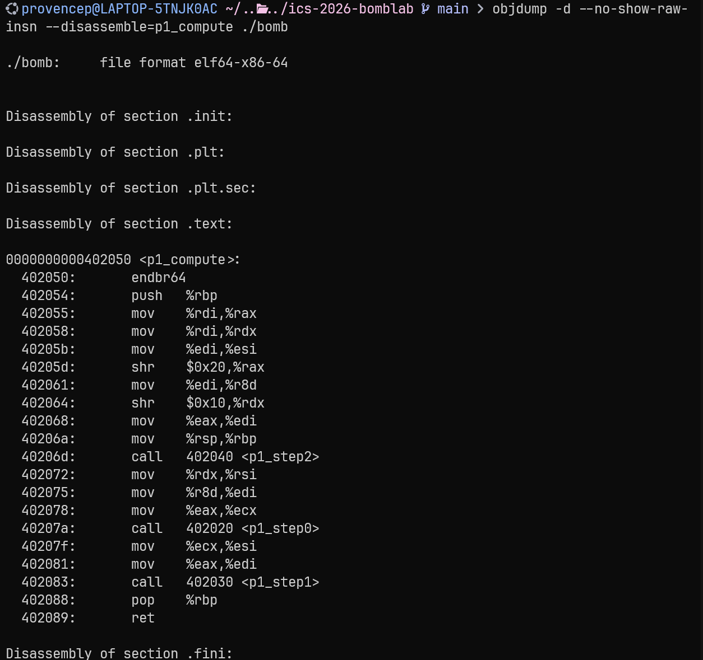

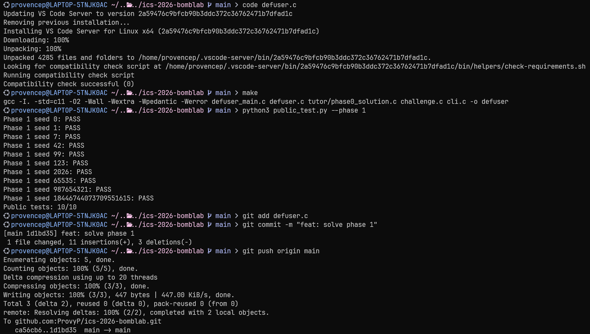

### 3.5 从 Phase 1 得到的通用分析方法

对后面的关卡，我继续沿用以下顺序：先看 `phase_0N` 的参数、`valid_u32_fields` 的字段数和 `sscanf` 的解析结果；再用 `call`、`jxx`、`ret`、`cmp` 等指令找到计算块；接着追踪 challenge 和输入在寄存器、栈与辅助函数之间的流动；最后才研究计算块的具体机制。

这样做可以避免把大部分时间花在输入解析和栈帧恢复等重复结构上。后续关卡真正新增的内容，是计算部分采用了数组循环、跳转表、递归、链表和函数指针等不同组织形式。

## 四、Phase 2—6：沿同一框架分析不同计算机制

以下均以个人炸弹的汇编和运行记录为依据。每关按“入口与返回条件—计算结构—寄存器或数据流—C 实现”的次序整理。由于汇编中的 `eax`、`edi`、`esi` 等只进行 32 位运算，恢复公式时原则上使用 `uint32_t`，防止误把回绕运算当作无限精度或有符号整数计算。

### 4.1 Phase 2：六个整数与循环递推

**入口和输入数量。** `valid_u32_fields` 的第二个参数为 6，`sscanf` 后又检查 `%eax == 6`。因此本关需要六个无符号整数。与 Phase 1 不同，`sscanf` 除字符串和格式外还要接收六个输出地址，部分地址放在寄存器中，剩余的通过栈传递。分析时不能把这里的 `push` 全部理解成普通的寄存器保存。

**计算结构。** 先计算并比较首项，然后进入循环逐项检查。首项附近的汇编是：

```asm
shr    $0x1c,%rax
and    $0x7f,%eax
xor    $0x1b,%eax
cmp    %eax,%esi
```

它取 challenge 右移 28 位后的低 7 位，再异或 `0x1b`，所以：

```c
values[0] = (uint32_t)((challenge >> 28) & 0x7fU) ^ 0x1bU;
```

后面出现向前回跳和循环更新：

```asm
lea    (%rsi,%rsi,2),%esi
shr    %cl,%rax
and    $0x3f,%eax
add    %edx,%eax
xor    %esi,%eax
...
```

`lea (%rsi,%rsi,2),%esi` 相当于把前一项乘 3；`edx` 表示下标 `i`（1 至 5）；`ecx` 保存移位量，从 10 开始每轮加 5。`shr %cl,%rax` 使用 `cl` 指定移位位数，结果经 `and $0x3f` 取出 6 位。逐项整理便得到：

\[
\begin{aligned}
v_0&=((challenge\gg28)\ \&\ 127)\oplus0x1b,\\
v_i&=(3v_{i-1})\oplus\left(\big((challenge\gg(10+5(i-1)))\ \&\ 63\big)+i\right),\quad 1\le i\le5.
\end{aligned}
\]

实现时用 `for` 计算后五个值，并将 `count` 设置为 6。这里需要弄清的不是每次循环所有寄存器的瞬时值，而是**循环变量、前一项、新一项和回跳终止条件**之间的关系。

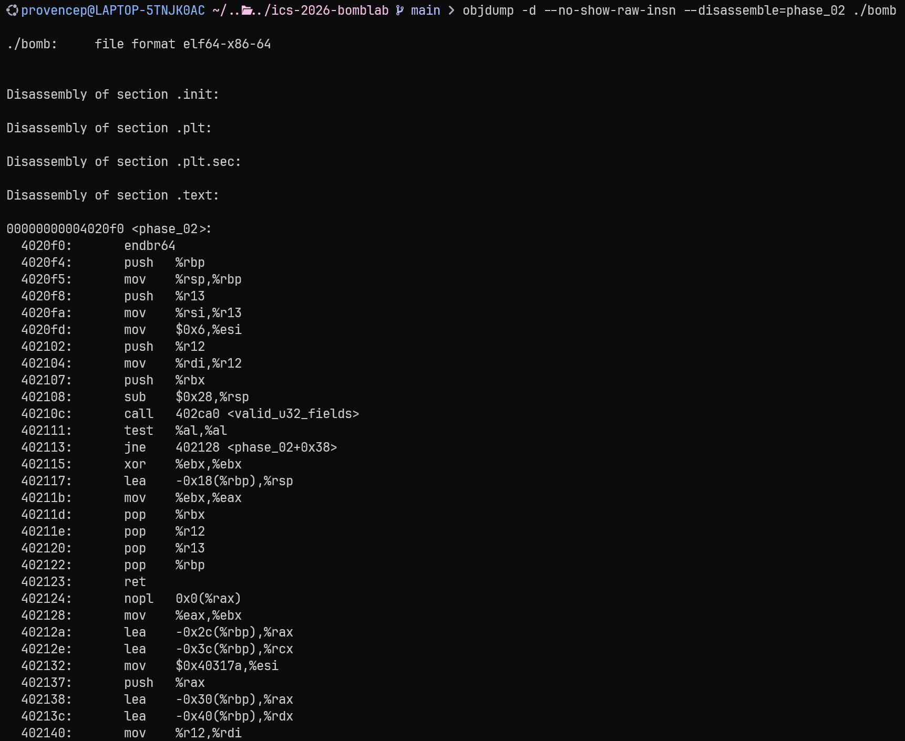

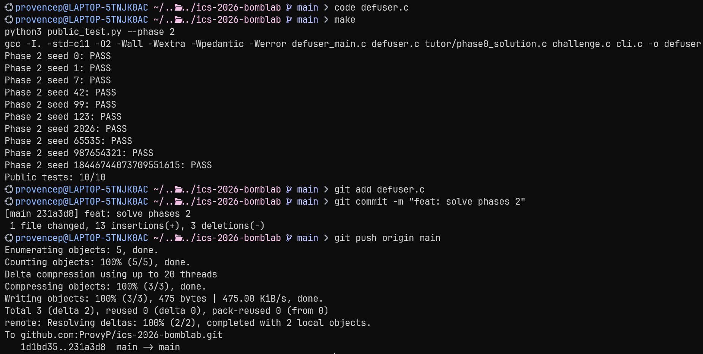

### 4.2 Phase 3：两个整数与跳转表

**入口和比较。** 输入字段数为 2。第一个数直接由 challenge 的最低三位决定：

```c
uint32_t selector = (uint32_t)(challenge & 7U);
```

第二个数由 `p3_dispatch` 计算，其输入还包括：

```c
uint32_t x = (uint32_t)(challenge >> 32)
           ^ (uint32_t)(challenge >> 3);
```

`phase_03` 会先验证 `selector`，然后验证第二个整数是否等于分发函数的返回值。这样我们不需要从头遍历所有分支，先知道选择条件，再去分析被选择的计算块。

**特殊机制：间接跳转。** `p3_dispatch` 中有：

```asm
cmp    $0x7,%eax
ja     <默认分支>
notrack jmp *0x405820(,%rax,8)
```

它并不按编号直接调用 `p3_case_0`、`p3_case_1`……，而是以索引在 `0x405820` 处读取一个 8 字节地址并跳过去。因此只看符号名称会猜错。使用 GDB 的 `x/8a 0x405820` 读取跳转表，恢复出以下关系：

| selector | 实际 case | 第二个整数的计算（32 位） |
| ---: | --- | --- |
| 0 | `p3_case_2` | `(x ^ 0xdfecU) + (x >> 2)` |
| 1 | `p3_case_3` | `5U * x + 0x4e6e7U` |
| 2 | `p3_case_5` | `5U * x + 0xaa95U` |
| 3 | `p3_case_7` | `(2U * x) ^ 0x2147U` |
| 4 | `p3_case_4` | `5U * x + 0xf541U` |
| 5 | `p3_case_0` | `5U * x + 0x20dU` |
| 6 | `p3_case_1` | `(4U * x) ^ 0x2a09U` |
| 7 | `p3_case_6` | `(x ^ 0x5f5cU) + (x >> 2)` |

**恢复 C。** `solve_phase_3` 输出两个字段：`values[0] = selector`，`values[1]` 用 `switch (selector)` 按上表计算。这个关卡显示，仅从 `jmp` 识别“这里有分支”还不够，**真正的分支映射藏在内存中的表项里**，必须把表也作为程序数据来分析。

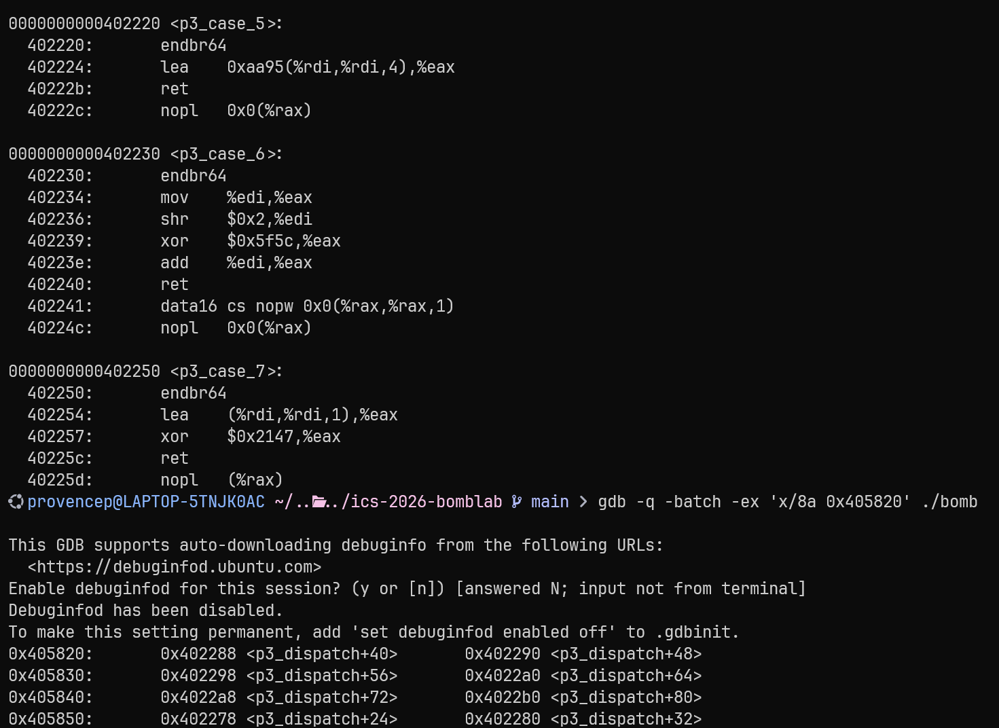

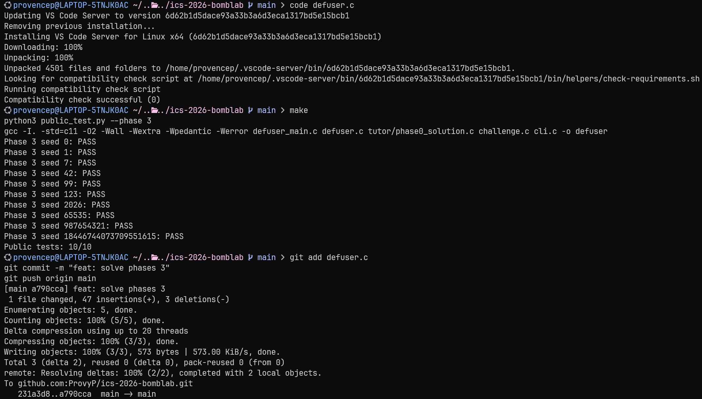

### 4.3 Phase 4：一个整数与递归路径计算

**入口和参数。** 本关输入字段数为 1，正确值来自 `p4_walk`。入口调用为这个函数准备了四个数：

```c
uint32_t target = (uint32_t)(challenge & 0x7fU);
uint32_t low = 0, high = 127;
uint32_t extra = (uint32_t)(challenge >> 7)
               ^ (uint32_t)(challenge >> 32);
```

这四个值分别经 `rdi`、`rsi`、`rdx`、`rcx` 传给递归函数，最后由 `eax` 带回一个 32 位结果用于比较。

**特殊机制：递归。** 在 `p4_walk` 中，函数再次调用自身，并且每次都计算区间中点：

```asm
mov    %edx,%edi
sub    %esi,%edi
shr    $1,%edi
add    %esi,%edi
...
call   402340 <p4_walk>
```

由参数 `target∈[0,127]`、`low=0`、`high=127` 可以推测二分查找，再结合递归调用的参数变化确认：

\[
mid=low+\left\lfloor\frac{high-low}{2}\right\rfloor.
\]

真正要注意的是**递归返回以后还要做运算**，所以答案不是简单的查找下标。按分支整理后的函数为：

```c
uint32_t walk(uint32_t target, uint32_t low,
              uint32_t high, uint32_t extra) {
    uint32_t mid = low + ((high - low) >> 1);
    if (target == mid)
        return (mid + 0x72U) ^ extra;
    if (target < mid)
        return (3U * walk(target, low, mid - 1, extra))
               ^ (mid + extra) ^ 0xaU;
    return (3U * walk(target, mid + 1, high, extra))
           ^ (mid + extra) ^ 0x1eU;
}
```

递归停止条件是 `target == mid`；左分支缩小上界，右分支抬高下界，并在返回后用不同常量编码路径。在 `solve_phase_4` 中保留这种递归结构，比强行改写成循环更容易对照汇编检查。

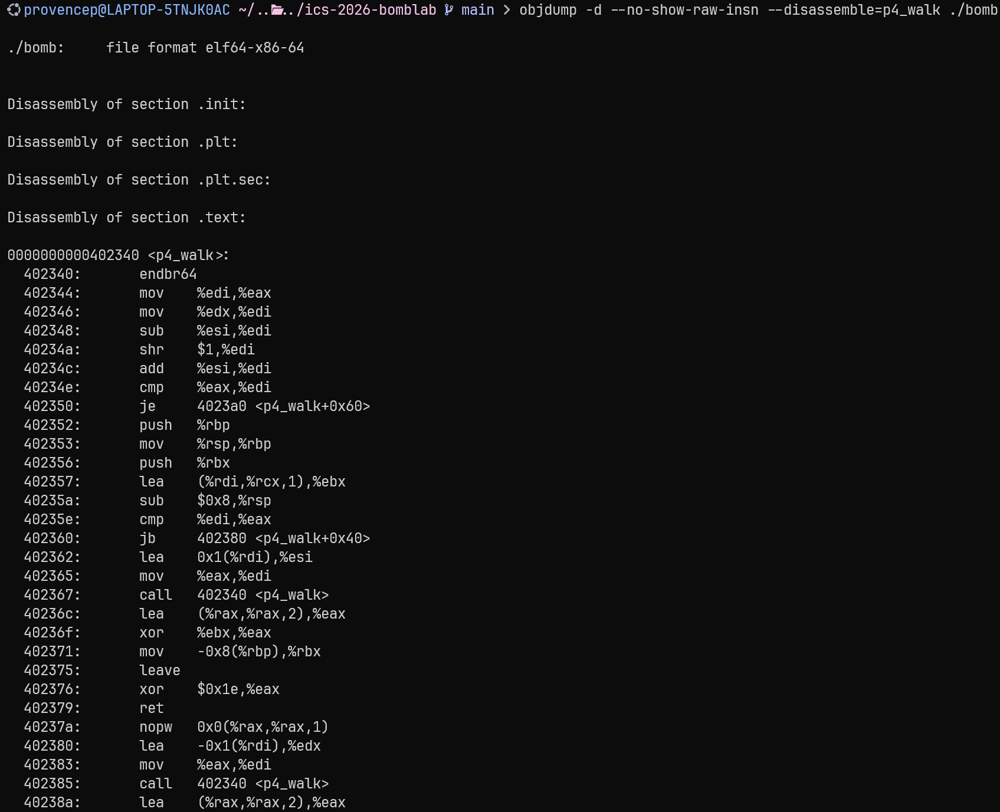


### 4.4 Phase 5：两个整数、指针输出与链表

**入口和参数。** 本关再次要求两个整数，但它没有通过两个独立计算函数分别返回结果。主函数调用 `p5_traverse` 时，传入 challenge 和一个栈上地址：

```asm
lea    -0x14(%rbp),%rsi
mov    %r12,%rdi
call   p5_traverse
```

说明辅助函数除用 `eax` 返回一个结果，还会通过指针写回另一个结果。结合后面的两次比较，可将其理解为：

```c
uint32_t p5_traverse(uint64_t challenge, uint32_t *last_value);
```

第一个输入对应返回值，第二个输入对应 `*last_value`。这也是理解参数类型的一条新线索：**参数寄存器中出现栈地址，往往意味着被调用函数可能通过指针写回数据**。

**特殊机制：静态链表。** 核心选择指令是：

```asm
and    $0x7,%eax
mov    0x405b60(,%rax,8),%rdx
```

先取 challenge 的最低三位，再把它作为索引从八个指针中选一个链表头。遍历时看到：

```asm
mov    (%rdx),%rdx
mov    0x8(%rdx),%esi
add    0xc(%rdx),%eax
```

结合 GDB 的节点内存输出，可以恢复结构体布局：

```c
struct Node {
    struct Node *next;   // offset +0，8 字节
    uint32_t value;      // offset +8
    uint32_t salt;       // offset +12
};
```

`(challenge >> 3) & 3` 决定从所选头节点向后移动多少步（0 至 3）。**即使步数为 0，也会处理起始节点本身**。每访问一个节点，累计值都需要更新，因此不能简单地只读取最后的节点值。

真正费时的不是 `add`、`xor` 之类的算术，而是这些 `value`、`salt` 数据没有作为直接立即数出现在指令中。为此，我使用 GDB 读取 `0x405b60` 指向的入口表及后续节点。最初把批量命令直接交给 `gdb -batch` 没有得到预期结果，改用临时 `.gdb` 脚本，并先执行 `starti` 让程序映射进调试进程后，才成功读取节点。

八个表头指向同一条链表的不同位置；沿 `head[0]` 开始的访问顺序，整理出以下需要的节点数据：

| 逻辑位置 | value | salt |
| ---: | ---: | ---: |
| 0 | `0x633` | `0xad2d` |
| 1 | `0x86b` | `0xb9a9` |
| 2 | `0x030` | `0xeb52` |
| 3 | `0x467` | `0x826d` |
| 4 | `0x369` | `0xf097` |
| 5 | `0x96d` | `0xe91c` |
| 6 | `0x276` | `0x48b4` |
| 7 | `0xa16` | `0x7073` |
| 8 | `0x51d` | `0x6cf0` |
| 9 | `0xb73` | `0x1634` |
| 10 | `0x147` | `0x77e4` |

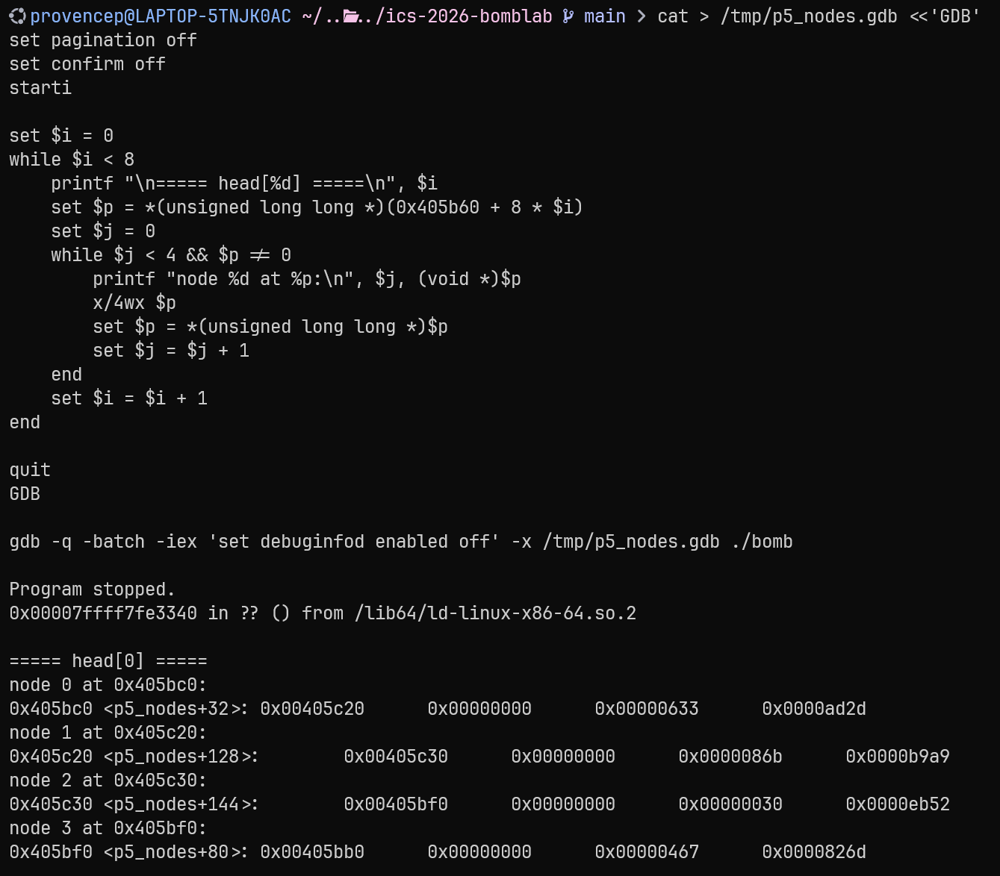

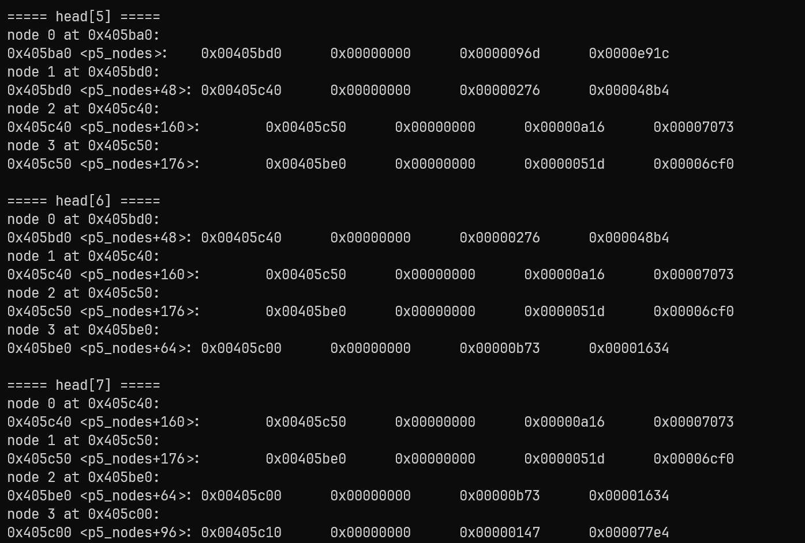

**数据流与计算关系。** 从 challenge 提取 `head`、`steps` 并计算初始累计值：

```c
uint32_t head = (uint32_t)(challenge & 7U);
uint32_t steps = (uint32_t)((challenge >> 3) & 3U);
uint32_t acc = (uint32_t)(challenge >> 6)
             ^ (uint32_t)(challenge >> 32) ^ 0xe178U;
```

从 `head` 开始，访问 `head` 到 `head+steps` 的节点，每次做：

```c
acc = 5U * (acc + salt[i]) ^ value[i];
```

最终两个答案分别是 `acc` 和 `value[head+steps]`。由于表头和最多移动三步的范围都已固定，可以用长度为 11 的常量数组表示数据和遍历次序，而不必在 `defuser.c` 中重新搭建链表。这个关卡说明：分析数据结构时除了控制流，还必须观察**内存布局及指针本身的变化**。

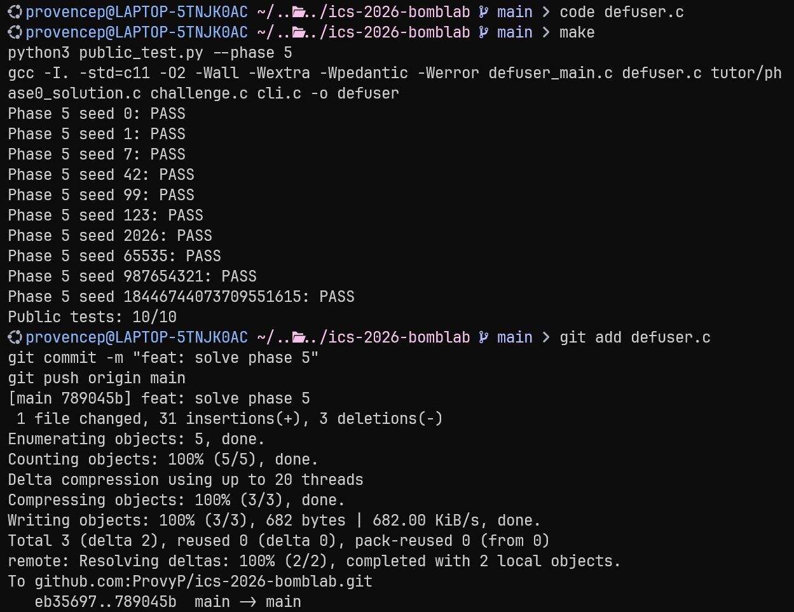

### 4.5 Phase 6：一个整数与两次函数指针调用

**入口和比较。** 输入字段数回到 1，主函数调用 `p6_dispatch(challenge)`，再比较其返回值与唯一的输入整数。真正的变化发生在计算函数中。

**特殊机制：函数指针表。** 其关键指令为：

```asm
and    $0x38,%ebx
and    $0x7,%eax
call   *0x405e00(,%rax,8)
xor    $0x23e3,%eax
mov    %eax,%edi
call   *0x405e00(%rbx)
add    $0xbea,%eax
```

Phase 3 使用 `jmp *地址` 跳入分支；这里使用 `call *地址` **真正调用函数**，并且连续执行两次。查阅 `0x405e00` 处的八个函数指针后，得到映射：

| 表索引 | 操作函数 |
| ---: | --- |
| 0 | `p6_op_5` |
| 1 | `p6_op_3` |
| 2 | `p6_op_0` |
| 3 | `p6_op_0` |
| 4 | `p6_op_3` |
| 5 | `p6_op_1` |
| 6 | `p6_op_4` |
| 7 | `p6_op_2` |

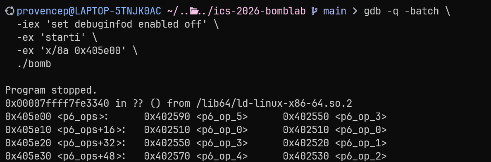

再逐个查看 `p6_op_0` 至 `p6_op_5`，它们本身就是短小的 32 位计算：

| 函数 | 对输入 `x` 的计算 |
| --- | --- |
| `p6_op_0` | `(x + 0xe222U) ^ (x >> 5)` |
| `p6_op_1` | `(x >> 1) \| (x << 31)`，循环右移 1 位 |
| `p6_op_2` | `((x << 5) + 0x84c5U) ^ (3U * x)` |
| `p6_op_3` | `(x ^ 0x9e32U) + (x << 7)` |
| `p6_op_4` | `((x >> 5) ^ x) + 0x760fU` |
| `p6_op_5` | `((x << 2) \| (x >> 30)) ^ 0xcbfU`，循环左移 2 位后异或 |

**寄存器与调用顺序。** challenge 决定计算的初始值和两次选择的函数：

```c
uint32_t x = (uint32_t)(challenge >> 6)
           ^ (uint32_t)(challenge >> 32);
uint32_t i = (uint32_t)(challenge & 7U);
uint32_t j = (uint32_t)((challenge >> 3) & 7U);

uint32_t first = p6_apply(ops[i], x);
uint32_t second = p6_apply(ops[j], first ^ 0x23e3U);
uint32_t answer = second + 0xbeaU;
```

这里 `ops` 是前面的函数索引表，`p6_apply` 可以用 C 的 `switch` 实现六种运算。要特别留意：第二次输入的是**第一次计算结果异或常量后的值**，而不是再次从原始 challenge 计算；以及 `ROL`、`ROR` 是循环移位，不能直接当成普通左移、右移。


### 4.6 六关机制的横向比较

回看六关，Phase 1 提供的是读懂入口结构的方法，后面各关的主要区别都可以定位到计算块：

| 关卡 | 输出整数数目 | 计算块的主要机制 | 重点追踪的对象 |
| --- | ---: | --- | --- |
| Phase 1 | 1 | 多个辅助函数组合 | 参数、返回值、`lea` 算术 |
| Phase 2 | 6 | 循环与数组递推 | 下标、前一项、移位量、循环边界 |
| Phase 3 | 2 | `switch` 跳转表 | selector、表地址与 case 映射 |
| Phase 4 | 1 | 二分递归 | 停止条件、左右分支、返回后计算 |
| Phase 5 | 2 | 链表与指针输出 | 节点布局、头指针、遍历顺序 |
| Phase 6 | 1 | 两次函数指针调用 | 函数表、两次选择和中间值 |

因此不需要把每关的入口函数重新从第一条指令解释一遍。先按 Phase 1 的方法确认骨架，再识别计算块对应哪一种机制，就能快速找到值得继续反汇编或使用 GDB 的位置。

## 五、Honor：字符串入口、缓冲区偏移与组合计算

Honor 与正式六关不同，它通过第七行文本触发。求解函数接收 `challenge`、`context` 两个 64 位值；后者由同一个 seed 下的前六关答案形成。这里需要先把外层的字符串格式检查和内层的三个整数计算分开。

### 5.1 `secret_gate`：从控制流恢复字符串布局

`secret_gate` 先调用 `strlen`，其后的长度判断为：

```asm
sub    $0x24,%rax
cmp    $0x7f,%rax
jbe    <继续处理>
```

这意味着字符串长度应处于 36～163 字节之间。然后 `secret_copy` 把输入复制到局部缓冲区，`secret_gate` 检查：

```asm
cmpl   $0x4e45504f,-0xb0(%rbp)
...
lea    -0xac(%rbp),%rdi
call   <secret_phase>
```

从局部缓冲区起始地址算，`rbp-0xb0` 是偏移 32，连续四个字节必须等于小端序整数 `0x4e45504f`。按小端字节排列是 `4f 50 45 4e`，对应 ASCII 字符串 `OPEN`。传给 `secret_phase` 的 `rbp-0xac` 则是偏移 36，也就是紧接在 `OPEN` 后面的文本。

因此可以构造为：

```text
AAAAAAAAAAAAAAAAAAAAAAAAAAAAAAAAOPEN<第一个数> <第二个数> <第三个数>
```

即 32 个填充字节、固定的 `OPEN`、再接三个无符号十进制整数。尖括号只是说明字段的占位符，并非实际输入内容。这里对内存偏移的推断比研究填充字符本身更重要。

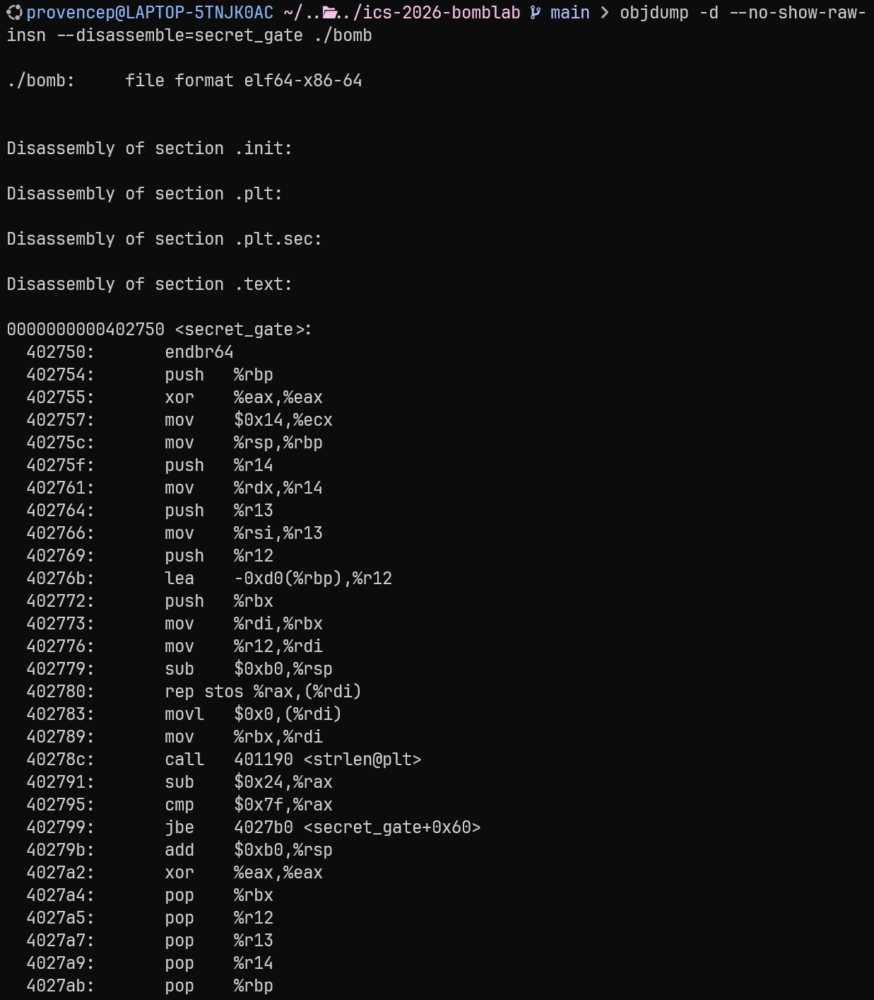

### 5.2 `secret_phase`：三个字段与 `secret_mix`

`secret_phase` 使用 `valid_u32_fields(input, 3)` 检查后半段，并通过 `sscanf` 读取三个整数。第一个数取 `context` 的最低两位。其余两个数要从 challenge、context 各自的高低 32 位构造中间量：

```c
uint32_t first = (uint32_t)(context & 3U);
uint32_t a = (uint32_t)challenge ^ (uint32_t)(challenge >> 32);
uint32_t b = (uint32_t)context ^ (uint32_t)(context >> 32);
uint32_t mask = first * 0xefd1U ^ (uint32_t)(context >> 16);
```

辅助函数 `secret_mix` 只有两步主要计算：

```asm
lea    0xefd1(%rdi,%rdi,4),%eax
xor    $0xfc6e,%eax
```

也就是 `secret_mix(x) = (5*x + 0xefd1) ^ 0xfc6e`。结合 `secret_phase` 中依次对三个输入字段的比较，可得：

```c
uint32_t second = ((5U * (a ^ b) + 0xefd1U) ^ 0xfc6eU) ^ mask;
uint32_t third  = second ^ (b + first + 0xfc6eU + (a >> 1));
```

最终通过 `snprintf` 把完整第七行写入 `out`，并检查缓冲区截断。这里不使用正式六关的 `write_answer`，因为 Honor 还有 32 字节前缀和固定的 `OPEN` 文本。所有中间数仍需按 `uint32_t` 运算。

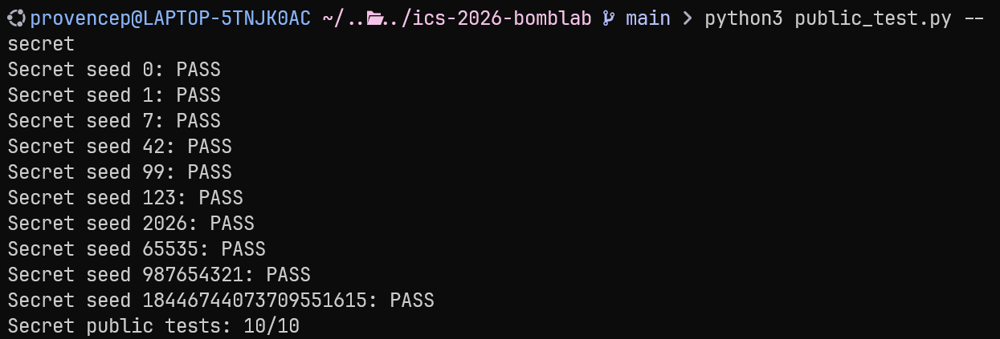

## 六、测试、验证与版本记录

### 6.1 公开 seed 测试

每完成一关，重新运行 `make`，并用 `python3 public_test.py --phase N` 测试。六关各有十个公开 seed，Honor 也有十个；全部实现后执行 `make test`，结果如下：

| 测试部分 | 结果 |
| --- | --- |
| Phase 1 | 10/10 PASS |
| Phase 2 | 10/10 PASS |
| Phase 3 | 10/10 PASS |
| Phase 4 | 10/10 PASS |
| Phase 5 | 10/10 PASS |
| Phase 6 | 10/10 PASS |
| Honor | 10/10 PASS |
| **合计** | **70/70** |

完整执行 Honor 时使用同一 seed 生成前六行以及第七行：

```bash
{ ./defuser --seed 42; ./defuser --secret --seed 42; } | ./bomb --seed 42
```

六关及 Honor 均显示 `defused`，说明完整输入流程能够通过。

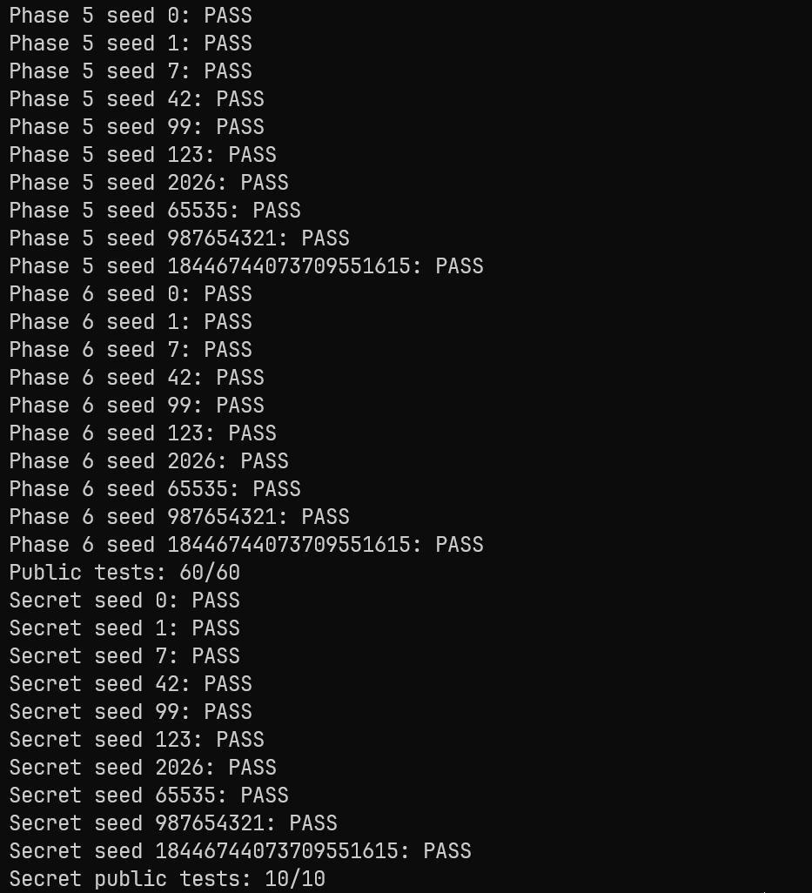

### 6.2 使用公开列表以外的 seed 43

固定公开 seed 的测试只能证明已列出的输入通过，不能代替对通用公式的检查。课程要求每个完成的关卡至少记录一次公开列表以外的 seed 验证，所以另外选取了 **43**，并在同一次运行中验证前六关和 Honor。

由于完整剧情输出很长，我把它保存到 `/tmp` 的临时日志，再提取最终判定信息：

```bash
seed=43
{ ./defuser --seed "$seed"; ./defuser --secret --seed "$seed"; } \
  | ./bomb --seed "$seed" > /tmp/bomblab_seed43.log

echo "Verification seed: $seed"
grep -E '^Phase [1-6] defused\.|^Congratulations!|^Secret phase defused\.|BOOM' \
  /tmp/bomblab_seed43.log
```

记录中依次出现：

```text
Verification seed: 43
Phase 1 defused.
Phase 2 defused.
Phase 3 defused.
Phase 4 defused.
Phase 5 defused.
Phase 6 defused.
Congratulations! You've defused the bomb.
Secret phase defused.
```

因此，**同一非公开 seed 43 对所有已完成关卡都有效**。上述命令没有更改程序行为，`grep` 只对已经保存的运行输出做显示筛选。

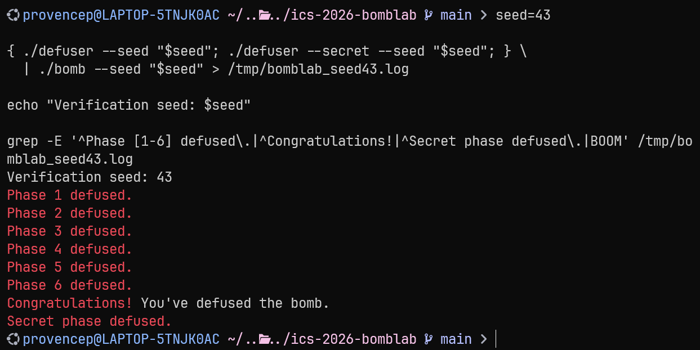

### 6.3 GitHub Actions 与提交记录

本地完成 Honor 后，将修改过的 `defuser.c` 和个人 `bomb` 一并提交。因为模板的 `.gitignore` 忽略 `bomb`，需要使用 `git add -f bomb`。记录中的代码提交为：

```text
cde4543 feat: solve honor and add personal bomb
```

随后 `git push origin main` 成功，本地 `git status` 显示工作区干净。GitHub 上对应提交的公开自测工作流状态为 Success：

[GitHub Actions：BombLab public tests，运行 #8](https://github.com/ProvyP/ics-2026-bomblab/actions/runs/39380514753)。

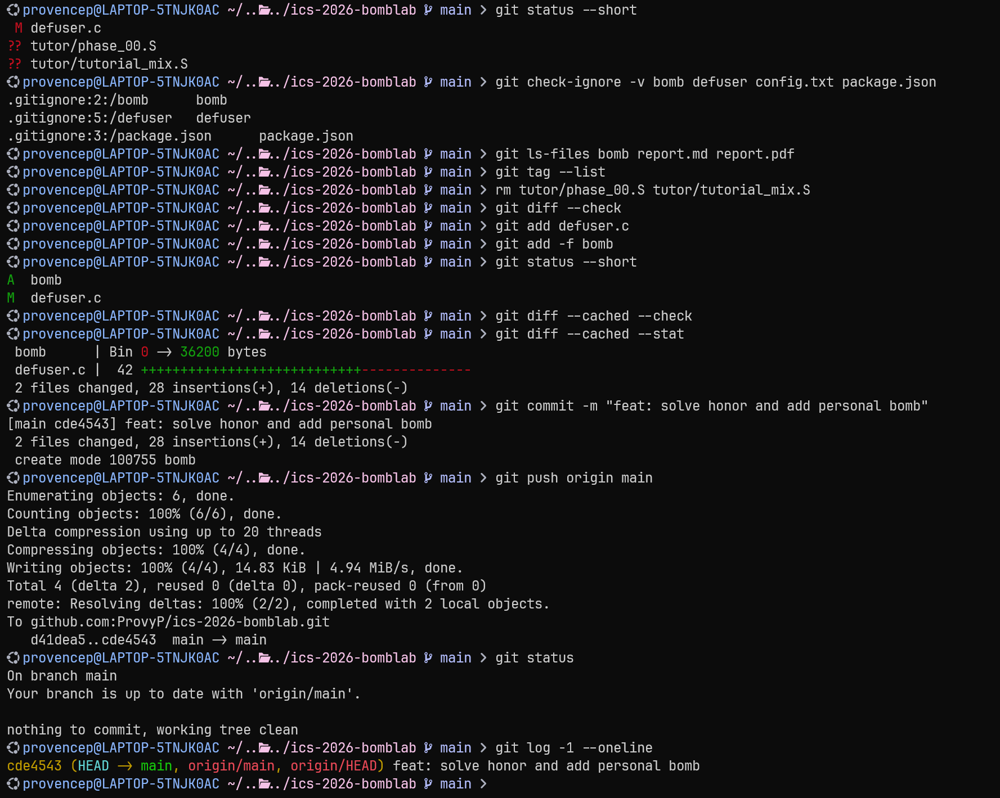

公开测试及 Actions 是本次实验的验证证据，但它们不等同于助教使用隐藏 challenge 得到的最终评分。

## 七、问题、收获与分析方法总结

### 7.1 实验过程中遇到的问题

**个人炸弹下载超时。** 第一次下载时出现连接或读取超时，由课程脚本自动切换 GitHub API 完成领取；没有通过修改炸弹或测试程序来解决。

**GDB 批量命令的执行问题。** Phase 5 需要读取较多静态节点。最初的批处理命令没有按预期工作，随后把命令写进 `/tmp/p5_nodes.gdb`，使用 `gdb -q -batch -x /tmp/p5_nodes.gdb ./bomb`，并先执行 `starti`，最终成功取得节点数据。这里要区分 GDB 读取命令、程序装载和目标内存访问这三件事。

**如何减少无效的反汇编阅读。** 一开始容易把全部汇编指令都当成同等重要的信息。重新梳理 Phase 1 后，先找输入解析、计算调用和比较出口，就可以把分析范围从整段函数缩小到真正影响答案的局部。对有清晰算术关系的关卡，以静态分析为主；涉及跳转表、链表和函数指针时，再针对性读取内存。

**完整运行输出过长。** 额外 seed 测试时使用日志保存和 `grep` 筛选，同时保留测试时的原始输出，方便截图展示全部通过信息。

### 7.2 对六关的理解

这次实验最大的收获不是记住某几个常量，而是能够把汇编还原成有层次的程序结构。我现在更倾向于先问：“这个函数接收什么、返回什么？有哪些提前退出的路径？最终比较的左右两个值来自哪里？”这些问题解决后，真正的计算部分往往不再复杂。

Phase 1 说明了这种整体结构分析的意义。Phase 2 的关键在循环更新和前后项递推；Phase 3 要额外读取跳转表，不能凭 case 名称猜测；Phase 4 必须区分递归前的搜索范围和递归后的返回值计算；Phase 5 的核心是把节点偏移和内存中的实际数据结合；Phase 6 则要保留函数表的映射和两次调用的顺序。Honor 进一步说明，复杂的输入格式可以先拆分为字符串布局检查和数值检查两个问题。

贯穿这些关卡的另一条原则是保持运算宽度。`eax` 中的 32 位无符号结果可能回绕；循环移位不能误写成普通移位；比较操作数在内存中时，还要注意 `lea` 得到的是地址还是 `mov` 取出的内容。这些细节单独看都不难，但会直接影响通用 solver 在不同 challenge 下的正确性。

### 7.3 参考资料

1. [复旦大学计算机系统基础（2026 秋）Lab2：BombLab](https://ics-26fall-fdu.github.io/labs/lab2-bomb-lab/)：实验规则、接口、调试方法及提交要求。
2. [课程 BombLab 模板仓库](https://github.com/ICS-26Fall-FDU/BombLab)：`tutor/` 源码、模板和公共测试工具。
3. [GNU GDB 官方文档](https://sourceware.org/gdb/documentation/)：断点、寄存器、内存查看及命令脚本。
4. 本地 `objdump`、`nm` 和 binutils 帮助信息。
5. 本人个人炸弹的反汇编结果、GDB 读取记录、`defuser.c` 和公开/额外 seed 的验证记录。
